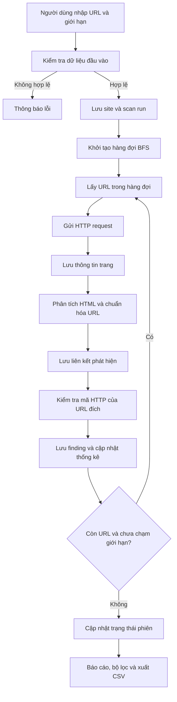

# Tài liệu báo cáo và bảo vệ đề tài — LinkScope

## 1. Tên đề tài

**Xây dựng website kiểm tra liên kết hỏng trên website bằng PHP thuần và MySQL.**

## 2. Bài toán và mục tiêu

Một website có thể chứa liên kết dẫn đến trang không tồn tại, tài nguyên bị xóa, máy chủ lỗi hoặc URL chuyển hướng. Kiểm tra thủ công mất thời gian và khó lưu lịch sử. LinkScope tự động thu thập URL trong phạm vi được cấu hình, gửi HTTP request, phân loại kết quả, lưu dữ liệu và cung cấp báo cáo CSV.

Mục tiêu chính:

1. Xây dựng giao diện quản lý và khởi chạy phiên quét.
2. Cài đặt crawler cơ bản bằng PHP, duyệt theo BFS có giới hạn.
3. Kiểm tra phản hồi HTTP và phân loại kết quả.
4. Lưu phiên quét, trang, liên kết và kết quả vào MySQL bằng PDO.
5. Xem lịch sử, lọc báo cáo và xuất CSV.

## 3. Công nghệ sử dụng

- **PHP thuần:** xử lý form, logic crawler, HTTP request và điều phối các trang.
- **PDO:** kết nối database, prepared statements để truyền dữ liệu an toàn hơn.
- **MySQL/MariaDB:** lưu cấu hình website, phiên quét, trang, liên kết và kết quả.
- **HTML/CSS/Bootstrap 5:** tạo giao diện responsive.
- **CSV UTF-8 BOM:** hỗ trợ Excel nhận diện tiếng Việt.
- **XAMPP:** môi trường chạy Apache, PHP và MySQL cục bộ.

## 4. Kiến trúc dữ liệu

- `sites`: cấu hình website, URL bắt đầu, domain và giới hạn quét.
- `scan_runs`: mỗi lần chạy; lưu thời điểm, trạng thái, số trang, số liên kết, số lỗi.
- `pages`: các trang được crawler truy cập trong một phiên.
- `links`: các URL được phát hiện trên trang nguồn, gồm URL gốc, URL chuẩn hóa, loại tài nguyên và số dòng.
- `findings`: kết quả kiểm tra URL đích, mã HTTP, loại trạng thái và thông tin lỗi.

Quan hệ chính: một `site` có nhiều `scan_runs`; một phiên có nhiều `pages`, `links` và `findings`. Khóa ngoại giúp dữ liệu liên quan được liên kết và có thể xóa theo phiên/cấu hình nếu quản trị viên thực hiện thao tác xóa trong database.

## 5. Sơ đồ hoạt động

## 6. Thuật toán crawler

Crawler sử dụng **Breadth-First Search (BFS)**:

1. Đưa URL bắt đầu vào hàng đợi với độ sâu 0.
2. Lấy URL đầu hàng đợi, bỏ qua URL đã truy cập.
3. Kiểm tra hostname có thuộc danh sách domain được phép không.
4. Gửi HTTP request và lưu mã phản hồi, tiêu đề trang.
5. Phân tích một số thẻ HTML như `a`, `img`, `script`, `link`, `iframe`, `source`, `video`, `audio`, `form`.
6. Chuẩn hóa URL tương đối thành URL tuyệt đối; bỏ qua scheme không phải HTTP/HTTPS và các loại liên kết không cần request như `mailto:`.
7. Nếu URL thuộc domain được phép và chưa truy cập, thêm vào hàng đợi nếu không vượt quá độ sâu.
8. Kiểm tra URL đích, lưu kết quả và tiếp tục đến khi hàng đợi rỗng hoặc chạm giới hạn trang/thời gian.

Độ phức tạp tổng quát phụ thuộc số trang, số liên kết và chi phí mạng. Nếu có `V` trang và `E` liên kết được phát hiện, thao tác hàng đợi BFS lý tưởng là `O(V + E)`; trong ứng dụng thực tế, thời gian HTTP request thường là phần chiếm nhiều thời gian nhất.

## 7. Quy tắc mã HTTP

| Mã/nhóm | Ý nghĩa | Cách hiển thị |
|---|---|---|
| 2xx, ví dụ 200 | Thành công | `ok`, màu xanh |
| 3xx, ví dụ 301/302 | Chuyển hướng | `redirect`, màu vàng nếu mã này là phản hồi cuối cùng |
| 4xx, ví dụ 403/404 | Lỗi phía yêu cầu/quyền truy cập | `http_error`, màu đỏ |
| 5xx, ví dụ 500/503 | Lỗi máy chủ | `http_error`, màu đỏ |
| Không có mã phản hồi | Không kết nối được/timeout/DNS/TLS | `connection_error`, màu đỏ |

Nếu HTTP client tự theo chuyển hướng, mã nhận được có thể là mã cuối cùng (ví dụ URL cũ chuyển đến URL mới và trả `200`). Vì vậy công cụ này chưa phải bộ theo dõi đầy đủ chuỗi redirect.

## 8. Kịch bản demo trên XAMPP (5–7 phút)

1. **Giới thiệu (30 giây):** trình bày mục tiêu, PHP thuần, PDO và MySQL.
2. **Cài đặt (1 phút):** mở XAMPP, bật Apache/MySQL, chỉ database đã import trong phpMyAdmin.
3. **Dashboard (30 giây):** chỉ các thẻ tổng quan và biểu mẫu tạo phiên quét.
4. **Quét thử (1–2 phút):** nhập một website bạn sở hữu/được phép kiểm tra; đặt khoảng 10 trang, độ sâu 1–2, timeout 2–3 giây.
5. **Giải thích thuật toán (1 phút):** chỉ ra hàng đợi BFS, domain allowlist, chuẩn hóa URL và kiểm tra HTTP trong `scan.php`.
6. **Báo cáo (1 phút):** trình bày số trang, liên kết, đích hoạt động/lỗi, phân loại mã HTTP, bộ lọc.
7. **CSV và lịch sử (30–60 giây):** tải CSV, mở bằng Excel, quay lại lịch sử và mở báo cáo cũ.

Nên chuẩn bị trước một website thử nghiệm nhỏ có URL hợp lệ và URL trả 404 do chính bạn kiểm soát. Website bên ngoài có thể chặn crawler hoặc thay đổi trạng thái nên không đảm bảo kết quả demo giống nhau mọi lần.

## 9. Bộ câu hỏi bảo vệ và gợi ý trả lời

### Câu 1. Đề tài giải quyết vấn đề gì?
**Gợi ý:** Tự động tìm các URL có vấn đề trên website, giảm thao tác kiểm tra thủ công, lưu lịch sử và hỗ trợ xuất báo cáo để quản trị viên xử lý.

### Câu 2. Vì sao chọn PHP thuần thay vì framework?
**Gợi ý:** PHP thuần giúp thể hiện trực tiếp quy trình xử lý form, PDO, truy vấn SQL, crawler và session. Với dự án lớn, framework có thể giúp cấu trúc và bảo trì tốt hơn; đề tài chọn PHP thuần để phù hợp mục tiêu học tập.

### Câu 3. PDO là gì? Tại sao dùng PDO?
**Gợi ý:** PDO là lớp truy cập dữ liệu của PHP, hỗ trợ nhiều hệ quản trị cơ sở dữ liệu. Prepared statements tách câu SQL khỏi giá trị đầu vào, giúp giảm nguy cơ SQL injection và làm code nhất quán.

### Câu 4. BFS là gì và vì sao dùng?
**Gợi ý:** Breadth-First Search duyệt các nút theo từng lớp/độ sâu. Ở đây URL bắt đầu là nút đầu tiên; URL mới phát hiện được thêm vào hàng đợi. BFS dễ triển khai, dễ giới hạn độ sâu và số trang.

### Câu 5. Làm sao tránh quét vô hạn?
**Gợi ý:** Có tập URL đã truy cập, domain allowlist, giới hạn số trang, độ sâu, timeout mỗi request và tổng thời gian quét.

### Câu 6. URL tương đối khác URL tuyệt đối thế nào?
**Gợi ý:** URL tuyệt đối có scheme và hostname, ví dụ `https://example.com/about`. URL tương đối như `/about` hoặc `contact.html` cần ghép với URL trang nguồn để xác định đích thực tế.

### Câu 7. Ý nghĩa mã 200, 301, 403, 404 và 500?
**Gợi ý:** 200 là thành công; 301 là chuyển hướng vĩnh viễn; 403 là bị từ chối truy cập; 404 là không tìm thấy; 500 là lỗi nội bộ máy chủ.

### Câu 8. Mã 403 có luôn là liên kết hỏng không?
**Gợi ý:** Không nhất thiết. 403 có thể do quyền truy cập, WAF hoặc website chặn bot. Công cụ báo đó là kết quả cần xem lại, không khẳng định trang đã bị xóa.

### Câu 9. Tại sao một URL có thể trả mã khác nhau ở các lần quét?
**Gợi ý:** Website thay đổi, server quá tải, giới hạn tốc độ, khác biệt vùng mạng, xác thực, cookie hoặc chính sách chống bot có thể làm kết quả khác nhau.

### Câu 10. Database có những bảng nào?
**Gợi ý:** `sites` lưu cấu hình; `scan_runs` lưu phiên; `pages` lưu trang đã crawl; `links` lưu liên kết phát hiện; `findings` lưu kết quả kiểm tra đích.

### Câu 11. Vì sao cần lưu lịch sử?
**Gợi ý:** Để xem lại kết quả của phiên trước, so sánh theo thời gian bằng thao tác bổ sung, và tải lại báo cáo mà không phải quét lại ngay.

### Câu 12. CSV được dùng để làm gì?
**Gợi ý:** CSV là định dạng trao đổi bảng đơn giản, mở được trong Excel và các công cụ phân tích. BOM UTF-8 được thêm để Excel thường nhận đúng tiếng Việt.

### Câu 13. Công cụ có phát hiện mọi liên kết trên website không?
**Gợi ý:** Không. Công cụ phân tích HTML trả về từ máy chủ. Liên kết được sinh bằng JavaScript, SPA, nội dung cần đăng nhập hoặc cấu trúc HTML phức tạp có thể bị bỏ sót.

### Câu 14. Hệ thống xử lý lỗi như thế nào?
**Gợi ý:** Kiểm tra dữ liệu đầu vào trước khi quét, giới hạn giá trị cấu hình, dùng try/catch khi thao tác database, ghi lỗi kỹ thuật vào PHP error log và hiển thị thông báo thân thiện cho người dùng.

### Câu 15. Làm thế nào giảm nguy cơ SQL injection và XSS?
**Gợi ý:** Dùng PDO prepared statements cho dữ liệu SQL; dùng `htmlspecialchars` thông qua hàm `e()` khi hiển thị nội dung do người dùng/website cung cấp ra HTML.

### Câu 16. Hạn chế hiện tại là gì?
**Gợi ý:** Quét đồng bộ nên bị giới hạn bởi thời gian chạy PHP; chưa render JavaScript; không đăng nhập vào website; không theo dõi đầy đủ chuỗi redirect; chưa có đăng nhập và phân quyền; cần bổ sung bảo vệ SSRF nếu triển khai công khai.

### Câu 17. Nếu phát triển tiếp, bạn sẽ làm gì?
**Gợi ý:** Thêm đăng nhập/phân quyền, CSRF token, worker nền hoặc hàng đợi, lịch quét tự động, so sánh phiên, biểu đồ theo thời gian, retry có giới hạn, theo dõi chuỗi redirect và công cụ phân tích HTML mạnh hơn.

### Câu 18. Làm sao kiểm thử tính đúng đắn?
**Gợi ý:** Dùng website thử nghiệm do mình kiểm soát với endpoint trả 200, 301, 403, 404, 500; kiểm tra dữ liệu trong database; đối chiếu báo cáo và CSV; thử URL đầu vào sai và kiểm tra giới hạn quét.

## 10. Lời kết mẫu

“Đề tài đã xây dựng được một ứng dụng web PHP thuần kết nối MySQL qua PDO để thu thập liên kết trong phạm vi domain, kiểm tra phản hồi HTTP, lưu lịch sử và xuất báo cáo. Hệ thống phù hợp mục tiêu minh họa crawler và quản lý dữ liệu. Trong tương lai, em sẽ bổ sung hàng đợi nền, xác thực người dùng, cơ chế bảo vệ triển khai công khai và khả năng xử lý nội dung JavaScript để tăng độ tin cậy.”
