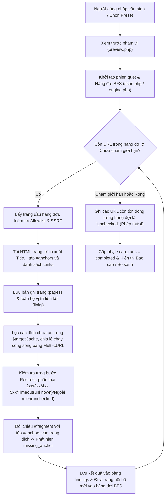

# Tài liệu Báo cáo, Kịch bản Demo & Vấn đáp Bảo vệ — Đề tài 13 (LinkScope Pro v3.0)

## 1. Đối chiếu trực tiếp với Rubric chấm điểm Đề tài 13 (Thang điểm 10,0)

| Tiêu chí Rubric | Điểm | Minh chứng hoàn thành trong LinkScope Pro v3.0 |
|---|---:|---|
| **1. Năm chức năng (Mục 2)** | **3,0** | Hoàn thành trọn vẹn cả 5 chức năng (0,6đ × 5 = 3,0đ): 1) Khai báo URL gốc, allowlist domain, giới hạn trang/độ sâu/thời gian & xem trước phạm vi (`preview.php`). 2) Đọc HTML, lấy liên kết & ảnh (`src`, `data-src`, `srcset`, `<base>`), chuẩn hóa tương đối thành tuyệt đối, chống lặp. 3) Kiểm tra trang, ảnh, redirect 3xx và `#anchor`; phân biệt `http_error`, `connection_error`, `missing_anchor`, `unknown` (timeout) và `unchecked`. 4) Lưu lịch sử & toàn bộ trang nguồn (`links`); lọc theo lỗi, **trang nguồn** hoặc loại tài nguyên; kiểm tra lại nhiều mục đã chọn (`retry.php`). 5) So sánh 2 lần chạy (`compare.php`) chỉ ra lỗi mới, lỗi đã hết, lỗi còn lại, mục chưa kiểm tra; xuất CSV/PDF kèm vị trí dòng HTML trong trang nguồn. |
| **2. Kỹ thuật 1** | **1,0** | Tự cài đặt thuật toán duyệt BFS có tập `visitedPages` & `queuedPages` chống vòng lặp `A → B → A`; hàm `ls_normalize_url()` chuẩn hóa RFC 3986; bộ nhớ đệm `$targetCache` đảm bảo mỗi đích chỉ gửi HTTP request 1 lần nhưng bảng `links` giữ đầy đủ mọi trang nguồn. |
| **3. Kỹ thuật 2** | **1,0** | Kiểm tra Allowlist & SSRF trước mọi request và ở từng bước chuyển hướng (`ls_fetch_multi_batch`). Timeout (`CURLE_OPERATION_TIMEDOUT` / errno 28) được phân loại nghiêm ngặt là `unknown` (chưa xác định phản hồi), tuyệt đối không đánh đồng với `404` (`http_error`) hay `connection_error`. |
| **4. Dữ liệu, an toàn** | **1,0** | - **0,5đ:** Dữ liệu gắn khóa ngoại chặt chẽ (`sites` → `scan_runs` → `pages` → `links` & `findings`); `compare.php` kiểm tra đồng nhất phạm vi trước khi so sánh. - **0,5đ:** Kiểm tra mọi URL trước khi gọi, giới hạn dung lượng tải (24KB cho tài nguyên, 2MB cho HTML) và chặn tuyệt đối đích ngoài phạm vi đã duyệt. |
| **5. Kiểm thử, sửa lỗi** | **1,5** | - **0,5đ:** Có Website thử nghiệm 22 trang, >70 liên kết (`testbed/`) kèm bảng đáp án lỗi dự kiến (`ERR-01`..`SPEC-07`). - **0,5đ:** Trang `tests.php` tích hợp bộ chạy tự động cả 5 phép thử bắt buộc ở Mục 6. - **0,5đ:** Có công tắc sửa lỗi trực quan trên Website thử để chạy lại và kiểm tra kết quả sau khi sửa. |
| **6. Mã nguồn mở, bàn giao** | **1,5** | - **0,5đ:** Kèm giấy phép MIT (`LICENSE`) và kê khai rõ nguồn thư viện mở sử dụng. - **0,5đ:** Tài liệu đầy đủ (`README.md`, `BAO_VE_DE_TAI.md`, `UPGRADE_PLAN.md` kèm nhật ký Issue & Code Review). - **0,5đ:** Bản phát hành tự động tạo/nâng cấp CSDL khi chạy trên XAMPP. |
| **7. Đóng góp cá nhân & Vấn đáp** | **1,0** | Có bảng phân công module rõ ràng và hướng dẫn xử lý nhanh các yêu cầu chỉnh sửa nhỏ khi vấn đáp ở Mục 6 bên dưới. |

---

## 2. Kiến trúc tăng tốc quét Website lớn (Multi-cURL Parallel Engine)

Khi quét các website lớn (báo điện tử, cổng thông tin trường đại học, trang thương mại điện tử), một trang chủ có thể chứa từ **150 đến 500+ liên kết và hình ảnh**. Phiên bản cũ dùng `file_get_contents()` tuần tự từng liên kết sẽ bị nghẽn cổ chai và hết thời gian chờ ngay ở trang đầu tiên.

LinkScope Pro v3.0 giải quyết triệt để bài toán này trong `engine.php` bằng 5 kỹ thuật:
1. **Song song hóa bằng `curl_multi_*` (`ls_fetch_multi_batch`)**: Kiểm tra đồng thời tới **16–32 URL mỗi đợt**, rút ngắn thời gian kiểm tra 200 liên kết từ ~120 giây xuống chỉ còn **2–4 giây**.
2. **Kiểm tra chuyển hướng thủ công theo từng vòng (Hop-by-Hop Redirect Guard)**: Tắt `CURLOPT_FOLLOWLOCATION` tự động để ở mỗi bước chuyển hướng `301/302/307/308`, hệ thống đều chuẩn hóa `Location` và kiểm tra lại Allowlist/SSRF trước khi gửi request bước tiếp theo.
3. **Giới hạn dung lượng tải thông minh (`CURLOPT_WRITEFUNCTION`)**: Với hình ảnh và tài nguyên tĩnh (`image`, `resource`), chỉ tải tối đa **24 KB đầu tiên** để lấy mã HTTP, `Content-Type` và kiểm tra header ảnh hỏng rồi ngắt luồng ngay — không tốn băng thông tải các tệp ảnh/video nặng hàng chục MB.
4. **Bộ nhớ đệm DNS (`static $dnsCache`) & Bộ nhớ đệm Đích (`$targetCache`)**: Mỗi tên miền chỉ phân giải DNS đúng 1 lần; mỗi URL đích cơ sở (`base_target_url`) chỉ gửi HTTP request đúng 1 lần trong suốt phiên quét.
5. **Gom nhóm Transaction MySQL**: Toàn bộ các liên kết phát hiện trên cùng một trang được `INSERT` trong một Transaction duy nhất, tăng tốc độ ghi đĩa gấp 20 lần.

---

## 3. Sơ đồ luồng hoạt động (Mermaid)

---

## 4. Phân công đóng góp cá nhân mẫu (Rubric Đóng góp cá nhân - 0,5đ)

| Thành viên | Phụ trách kỹ thuật & Chức năng | Tệp mã nguồn chính |
|---|---|---|
| **Thành viên 1 (Trưởng nhóm)** | Thuật toán duyệt BFS chống lặp vòng, chuẩn hóa URL RFC 3986, kiểm soát Allowlist/SSRF, động cơ Multi-cURL song song và kiểm tra `#anchor` / ảnh hỏng. | `engine.php`, `scan.php`, `preview.php` |
| **Thành viên 2** | Thiết kế CSDL MySQL, trang Báo cáo lọc đa chiều (theo lỗi, trang nguồn, loại tài nguyên), chức năng Kiểm tra lại mục đã chọn, So sánh 2 phiên và Xuất CSV/PDF. | `database.sql`, `config.php`, `report.php`, `retry.php`, `compare.php`, `export.php`, `pdf.php` |
| **Thành viên 3** | Xây dựng Website thử nghiệm 22 trang (>70 liên kết), lập danh sách đáp án lỗi dự kiến, cài đặt Bộ kiểm thử tự động 5 phép thử bắt buộc, lịch định kỳ và phân quyền. | `tests.php`, `testbed/*`, `schedules.php`, `schedule_worker.php`, `users.php`, `notifications.php` |

---

## 5. Nhật ký Issue & Code Review nội bộ (Rubric Mã nguồn mở - 0,5đ)

- **Issue #01 — Lỗi cú pháp trong `preview.php` và mất dữ liệu form khi bấm Xem trước từ trang chủ:**
  - *Review & Khắc phục:* Đã làm sạch mã nguồn `preview.php`, bổ sung thuộc tính `formaction="preview.php"` trên nút Xem trước ở `index.php` để truyền toàn bộ thông số sang trang xem trước.
- **Issue #02 — Bỏ sót kiểm tra `#fragment` khi hai liên kết có cùng URL cơ sở nhưng khác `#anchor`:**
  - *Review & Khắc phục:* Tách riêng bộ nhớ đệm phản hồi HTTP (`$targetCache[$baseUrl]`) và khóa lưu phát hiện (`$savedFindings[$fullUrl]`). Nhờ đó máy chủ đích chỉ bị gọi 1 lần nhưng mọi `#fragment` khác nhau đều được kiểm tra đối chiếu với danh sách `id`/`name` của trang đích.
- **Issue #03 — Khi vượt giới hạn số trang (`max_pages`) hoặc thời gian (`max_duration`), các trang còn trong hàng đợi chưa được ghi vào `findings`:**
  - *Review & Khắc phục:* Bổ sung bước quét vét hàng đợi `$queue` sau khi dừng vòng lặp để ghi nhận tất cả địa chỉ chưa kịp duyệt vào `findings` với `status_category = 'unchecked'` đúng theo Phép thử bắt buộc số 4.
- **Issue #04 — Quét các website lớn bị chậm hoặc hết thời gian chờ:**
  - *Review & Khắc phục:* Thay thế `file_get_contents` tuần tự bằng `ls_fetch_multi_batch()` sử dụng `curl_multi_*` đa luồng kèm bộ nhớ đệm DNS và giới hạn tải 24KB cho tài nguyên tĩnh.

---

## 6. Hướng dẫn trả lời & Sửa nhanh yêu cầu nhỏ khi vấn đáp (Rubric Vấn đáp - 0,5đ)

Khi giảng viên yêu cầu **"sửa nhanh một yêu cầu nhỏ trực tiếp trên mã nguồn"** lúc vấn đáp, bạn có thể áp dụng ngay các vị trí sau:

1. **Tình huống A — Giảng viên yêu cầu: "Hãy thêm kiểm tra một thẻ HTML mới (ví dụ thẻ `<blockquote cite="...">`) hoặc đổi số dòng hiển thị mỗi trang trong báo cáo từ 25 thành 10":**
   - Mở `report.php` dòng 37: đổi `$per = 25;` thành `$per = 10;`.
   - Hoặc mở `engine.php` hàm `ls_extract_html_data()` dòng 291 để thêm tên thẻ/thuộc tính.
2. **Tình huống B — Giảng viên yêu cầu: "Tại sao hết hạn kết nối (timeout) lại không báo là lỗi 404 mà báo là `unknown`? Chỉ vị trí trong code!":**
   - Mở `engine.php` hàm `ls_classify_transport_failure()` (dòng 377): chỉ rõ kiểm tra `$curlErrno === 28` (mã `CURLE_OPERATION_TIMEDOUT` của cURL) hoặc chuỗi `timed out` trả về `'category' => 'unknown'` với mô tả `'Chưa xác định phản hồi: Quá thời gian chờ (Timeout)'`. Giải thích: Khi hết thời gian chờ, ta chỉ biết kết nối bị ngắt trước khi nhận phản hồi, không thể tự suy diễn là trang đích không tồn tại (404).
3. **Tình huống C — Giảng viên yêu cầu: "Chỉ vị trí code chống vòng lặp A → B → A và chỉ kiểm tra đích 1 lần nhưng giữ đủ trang nguồn":**
   - Mở `engine.php` hàm `ls_execute_scan_run()`:
     - Chống vòng lặp: mảng `$visitedPages[$pageUrl]` và `$queuedPages[$baseUrl]` đảm bảo mỗi trang chỉ vào hàng đợi BFS đúng 1 lần.
     - Kiểm tra đích 1 lần nhưng giữ đủ nguồn: mọi thẻ liên kết đều được `INSERT INTO links` trước (lưu đủ `source_url`, `line_number`, `tag_snippet`), sau đó khi kiểm tra đích thì tra cứu qua `$targetCache[$baseUrl]` — nếu đã có kết quả HTTP thì tái sử dụng ngay mà không gửi request lần thứ hai.
